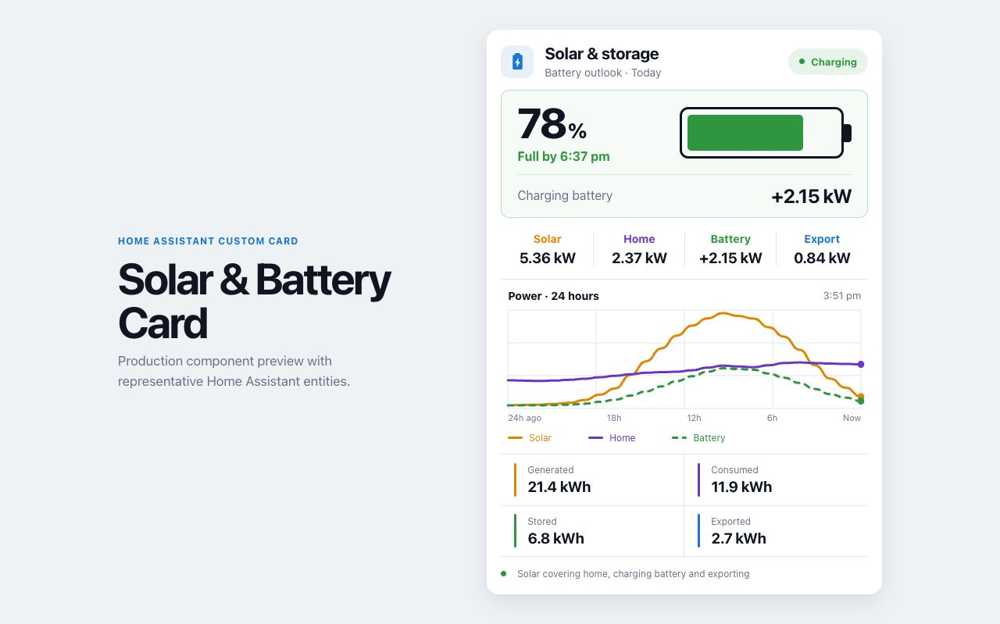

# Solar & Battery Card for Home Assistant

[](https://github.com/hacs/default)
[](https://github.com/halfbuilthq/solar-battery-card/releases)
[](https://github.com/halfbuilthq/solar-battery-card/actions/workflows/ci.yml)
[](LICENSE)

A custom Home Assistant dashboard card focused on solar generation, household
load, battery state, grid flow, and daily energy totals.



## Features

- Battery state of charge and charging/discharging outlook
- Live solar, home, battery, and grid power in kW
- Interactive 24-hour power history with mouse, touch, and keyboard inspection
- Daily generated, consumed, stored, and exported energy in kWh
- Native Home Assistant visual configuration using entity selectors
- Responsive full-width dashboard layout with automatic height
- Available in the default HACS catalogue

## Configuration

```yaml
type: custom:solar-battery-card
title: Solar & storage
battery_soc: sensor.battery_state_of_charge
solar_power: sensor.solar_power
home_power: sensor.home_power
battery_power: sensor.battery_power
grid_power: sensor.grid_power
solar_energy_today: sensor.solar_energy_today
home_energy_today: sensor.home_energy_today
battery_energy_today: sensor.battery_energy_today
export_energy_today: sensor.grid_export_energy_today
battery_capacity: 27
battery_positive_is_charging: true
grid_positive_is_export: true
show_power_chart: true
```

The first five entity fields are required. Daily energy entities and usable
battery capacity are optional.

### Choosing the correct entities

Entity IDs vary between installations. Match each field to the measurement it
represents; a similarly named entity with the wrong measurement type will
produce misleading results.

| Card field | Correct measurement | Units | Example entity |
| --- | --- | --- | --- |
| `battery_soc` | Current battery state of charge, from 0 to 100 | `%` | `sensor.battery_state_of_charge` |
| `solar_power` | Total instantaneous PV output | `W` or `kW` | `sensor.solarnet_power_photovoltaics` |
| `home_power` | Total instantaneous household load | `W` or `kW` | `sensor.solarnet_power_load_consumed` |
| `battery_power` | Signed instantaneous battery charge/discharge power | `W` or `kW` | `sensor.solarnet_power_battery` |
| `grid_power` | Signed instantaneous grid import/export power | `W` or `kW` | `sensor.solarnet_power_grid` |
| `solar_energy_today` | PV energy generated since local midnight | `Wh`, `kWh`, or `MWh` | `sensor.daily_pv_production` |
| `home_energy_today` | Household energy consumed since local midnight | `Wh`, `kWh`, or `MWh` | `sensor.daily_home_energy_consumed` |
| `battery_energy_today` | Energy charged into the battery since local midnight | `Wh`, `kWh`, or `MWh` | `sensor.battery_energy_stored_today` |
| `export_energy_today` | Energy exported to the grid since local midnight | `Wh`, `kWh`, or `MWh` | `sensor.daily_return_to_grid` |

Do not select a live `W` or `kW` power sensor for one of the daily energy
fields. If the integration does not provide a suitable daily energy entity,
create one using the helper instructions below.

### Fronius example

This is a complete example from a Home Assistant Fronius installation. The daily
entity IDs include locally created helpers and therefore may differ on another
Home Assistant system.

```yaml
type: custom:solar-battery-card
title: Solar & storage
battery_soc: sensor.battery_state_of_charge
solar_power: sensor.solarnet_power_photovoltaics
home_power: sensor.solarnet_power_load_consumed
battery_power: sensor.solarnet_power_battery
grid_power: sensor.solarnet_power_grid
solar_energy_today: sensor.daily_pv_production
home_energy_today: sensor.daily_home_energy_consumed
battery_energy_today: sensor.battery_energy_stored_today
export_energy_today: sensor.daily_return_to_grid
battery_positive_is_charging: false
grid_positive_is_export: true
show_power_chart: true
```

### Creating missing daily energy entities

First inspect the candidate source under **Developer tools → States**. There
are three common cases:

1. If it already reports energy used since midnight in `Wh`, `kWh`, or `MWh`,
   select it directly in the card.
2. If it reports a lifetime or other continuously increasing energy total,
   create a daily **Utility Meter** helper from it.
3. If it only reports instantaneous power in `W` or `kW`, create an
   **Integral** helper and then a daily **Utility Meter** helper.

#### From a cumulative energy sensor

Go to **Settings → Devices & services → Helpers → Create helper → Utility
Meter**, then use:

- **Input sensor:** the continuously increasing energy entity
- **Meter reset cycle:** Daily
- **Meter reset offset:** `0`
- **Supported tariffs:** leave empty
- **Net consumption:** Off
- **Delta values:** Off
- **Periodically resetting:** Off when the source never resets
- **Sensor always available:** Off unless retaining the last value during a
  source outage is deliberately preferred

Use the resulting Utility Meter entity in the corresponding daily card field.
Its first day is partial; the first complete result starts after the next
midnight. See the Home Assistant
[Utility Meter documentation](https://www.home-assistant.io/integrations/utility_meter/)
for sources that reset or report delta values.

#### From a power sensor

Go to **Settings → Devices & services → Helpers → Create helper → Integral**,
then use:

- **Input sensor:** the instantaneous power entity
- **Integral method:** Trapezoidal
- **Precision:** `3`
- **Metric prefix:** `k` when the source is in `W`; none when it is in `kW`
- **Integration time:** Hours
- **Maximum sub-interval:** 5 minutes

The resulting entity should report `kWh`. Next, create a daily Utility Meter
from that Integral entity using the settings in the previous section. See the
Home Assistant
[Integral documentation](https://www.home-assistant.io/integrations/integration/)
for details about sampling frequency and integration methods.

The following recipes cover all four optional daily fields:

| Daily card field | Example power source | Integral helper name | Utility Meter helper name |
| --- | --- | --- | --- |
| `solar_energy_today` | `sensor.solarnet_power_photovoltaics` | Solar energy total | Solar energy today |
| `home_energy_today` | `sensor.solarnet_power_load_consumed` | Home energy consumed total | Daily home energy consumed |
| `battery_energy_today` | `sensor.solarnet_power_battery_charge` | Battery energy stored total | Battery energy stored today |
| `export_energy_today` | `sensor.solarnet_power_grid_export` | Grid export energy total | Daily return to grid |

For battery storage and grid export, use a direction-specific, non-negative
power source such as `battery_charge` or `grid_export`. Integrating the signed
`battery_power` or `grid_power` entity can subtract discharging or importing
from the daily value and will not represent total energy stored or exported.

### Display units

Set `power_unit: W` or `power_unit: kW` (default) for live power and chart
tooltips. Set `energy_unit: Wh` or `energy_unit: kWh` (default) for daily
energy. These options change only the display; sensors and calculations keep
their original meaning. W/Wh display whole numbers; kW uses two decimal places
and kWh uses one. Capacity settings always use kWh.

### Today’s solar forecast

Optionally set `solar_forecast_today: sensor.your_forecast_today` to show a
“Forecast today” line below Generated. Choose the forecast for the **entire
current day**, not remaining-today energy, tomorrow, or instantaneous power.
Forecast.Solar and other integrations can supply this numeric sensor in Wh,
kWh or MWh; the card displays it using `energy_unit`.

Omitting the field hides the line. An unavailable entity, invalid value or
unsupported/missing unit shows an em dash; zero is displayed normally. The
forecast works even without an actual-generation sensor. Home Assistant’s
source integration manages updates and the day rollover. The card does not
call forecast services or use daily forecast totals to calculate battery ETA.

### Total capacity and reserve

Existing `battery_capacity` configurations keep the previous charging estimate.
To opt into charging and discharging estimates based on absolute SOC, use:

```yaml
battery_total_capacity: 5.12
battery_lower_soc: 10
```

Total capacity is the kWh represented by the sensor’s complete 0–100% SOC
range. The lower limit is the discharge reserve, from 0 to below 100 percent
(default 0). A nonzero reserve requires total capacity. Use an **absolute SOC**
sensor; if your integration rescales SOC around its reserve, supply a suitable
template sensor instead. These settings estimate energy; they do not control
the battery or change the actual SOC graphic.

At 50% SOC, a 5.12-kWh battery with a 10% reserve needs 2.56 kWh to fill and
has 2.048 kWh available above reserve. At a constant 1 kW, those are 2.56 hours
to full or 2.048 hours to reserve. Reserve does not reduce charging headroom.
The card shows “Full by”, “Reserve reached by”, or “At/below reserve”. Estimates
require valid SOC/power readings and charging/discharging above 50 W. Dates
are included when a new-model estimate crosses midnight, using Home Assistant’s
timezone when available. Estimates assume constant power and omit efficiency,
charge tapering, changing loads and future solar production.

If both capacities are supplied, `battery_total_capacity` takes precedence;
the legacy `battery_capacity` value is retained. Clear total capacity and reset
the reserve to zero to return to the legacy calculation. Total capacity must
be a finite positive number and supports 0.01-kWh input precision.

### Behaviour settings

- **Usable battery capacity** is the usable—not necessarily nameplate—battery
  capacity in `kWh`. It is only used to estimate when charging will finish and
  can be left blank.
- Enable **Positive battery power means charging** only when the battery power
  entity is positive while charging. Disable it if charging is negative.
- Enable **Positive grid power means export** only when the grid power entity
  is positive while exporting. Disable it if export is negative.
- **Show 24-hour power chart** controls the live-power history chart.

## Install with HACS

[](https://my.home-assistant.io/redirect/hacs_repository/?owner=halfbuilthq&repository=solar-battery-card&category=plugin)

1. Select the button above, or open **HACS → Dashboard** in Home Assistant.
2. Search for **Solar & Battery Card**—no custom repository is required.
3. Open the repository and select **Download**.
4. Refresh Home Assistant when prompted.
5. Add **Solar & Battery Card** from the dashboard card picker and configure it
   using the visual editor.

## Development

```sh
npm install
npm run dev
```

The development server serves a representative Home Assistant state fixture at
`http://127.0.0.1:5173/demo/`. Desktop preview controls exercise display units,
English/German text, battery states and missing solar forecasts.

Run the complete verification:

```sh
npm run check
```

The production bundle is emitted to `dist/solar-battery-card.js`.

## Manual installation

1. Copy `dist/solar-battery-card.js` to
   `<config>/www/solar-battery-card.js`.
2. Add `/local/solar-battery-card.js` as a JavaScript module dashboard
   resource.
3. Add the card from Home Assistant's card picker and configure its entities
   in the visual editor.

## Sign conventions

The card defaults to positive battery power meaning charging and positive grid
power meaning export. Both conventions can be reversed in the visual editor.
The selected battery convention is applied consistently to the live status and
the 24-hour chart. Charging is plotted above zero and discharging below zero.

## License

[MIT](LICENSE)
