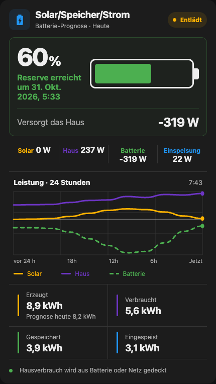
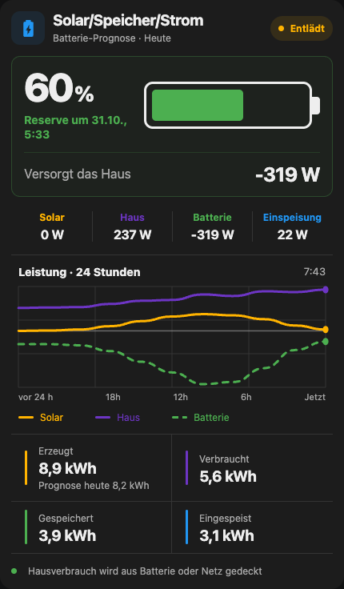
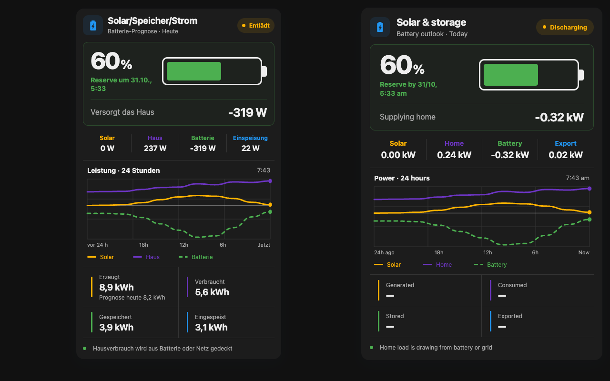

# Issue #12 — layout and battery caption

Verified on 1 November 2026 against the built release bundle.

The reporter's German screenshot shows short power labels and readings sharing
a line, while longer labels wrap. The power tiles had inline `span`/`strong`
children. They now use a column layout so the value is always below its label.
The host is also a width container, allowing compact padding to apply to its
`ha-card`; long titles and charge lines can shrink/wrap inside narrow cards.

The visible battery estimate now uses “Reserve by” / “Reserve um” with a compact
date. Same-year dates omit the year; dates across New Year keep it. The full
localized wording and date remain available in the caption's tooltip. Battery
calculations, reserve thresholds and sign conventions are unchanged.

## Validation

- Reproduced the inline-label bug against the previous bundle using the new
  browser test. The old bundle fails the label/value geometry assertion.
- All 174 unit tests pass, including compact dates, full-date formatting,
  Home Assistant timezones and New Year.
- TypeScript and the production build pass.
- Browser regression checks pass for 28 width/language/unit combinations:
  widths 280, 320, 360, 390, 430, 506 and 768; English/German; W/kW.
- Browser checks also cover charging/discharging/reserve/idle, regular and
  forecast charts, hidden charts, legacy capacity, New Year and full-date tooltips.
- No browser runtime errors occurred. Screenshots were visually inspected.
- CI runs the same browser checks with Playwright Chromium. The local check uses
  an isolated Chrome session and simulated Home Assistant entities, rather than
  a live Home Assistant installation.

Run `npm run check`, `npx playwright install chromium`, then `npm run test:layout`.
Set `SOLAR_LAYOUT_SCREENSHOTS` to a directory to capture the desktop and German
card previews. `PLAYWRIGHT_CHROMIUM_EXECUTABLE_PATH` can select an installed Chrome.

